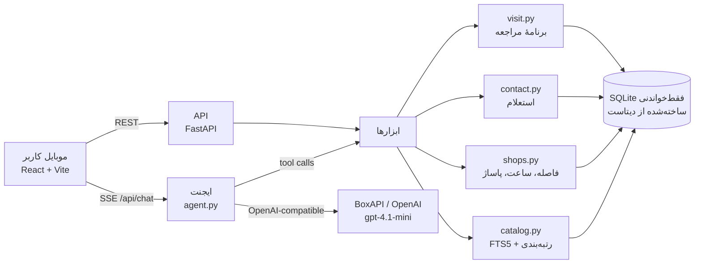

# بازارگرد: دستیار هوشمند خرید حضوری روی دادهٔ ترب

پروژهٔ چالش **ترب** در هکاتون Agentic AI استارکوچ (مهر ۱۴۰۵).

بازارگرد یک وب‌اپ موبایل‌محور، فارسی و راست‌به‌چپ است که کاربر را در هر چهار قدم خرید حضوری در تهران همراهی می‌کند:

1. **انتخاب کالا**: نیاز کاربر را می‌فهمد، اگر لازم باشد با چند گزینهٔ آماده (چیپ) سؤال می‌پرسد و از بین ۲۲۶ هزار کالای ترب پیشنهاد می‌دهد؛ برای هر پیشنهاد دلیل می‌آورد و امکان مقایسهٔ مشخصات را دارد.
2. **پیدا کردن فروشگاه‌های نزدیک**: بر اساس محل، شعاع، بودجه و شرط قسطی.
3. **مقایسهٔ فروشگاه‌ها**: قیمت ثبت‌شده و تازگی آن، فاصله و زمان رسیدن، باز بودن **در زمان رسیدن کاربر**، قسطی/ترب‌پی، گارانتی، و مسیر داخل پاساژ.
4. **هماهنگی با فروشگاه**: پیام استعلام را می‌نویسد، هم‌زمان از چند فروشگاه قیمت، موجودی و ساعت کاری را می‌پرسد، پاسخ‌ها را جدا از دادهٔ ثبت‌شده نشان می‌دهد، برای فروشگاه بی‌پاسخ یا ناموجود فوراً جایگزین می‌آورد و در آخر برنامهٔ مراجعه (ترتیب فروشگاه‌ها، ساعت رسیدن، مسیریابی با نشان/بلد/گوگل‌مپ) را می‌چیند.

> شماره تلفن‌های دادهٔ هکاتون ساختگی‌اند؛ بنابراین طرف فروشگاه در مرحلهٔ ۴ **شبیه‌سازی** می‌شود و این موضوع در رابط کاربری همه‌جا برچسب خورده است. بخش دستیار (نوشتن پیام، ارسال هم‌زمان، خواندن پاسخ، جدا کردن دادهٔ تأییدشده از ثبت‌شده، پیشنهاد جایگزین) واقعی است.

- نسخهٔ آنلاین: `https://bazargard.liara.run` (روی لیارا)
- ویدیوی دمو و سناریو: [VIDEO-SCRIPT.md](VIDEO-SCRIPT.md)
- یادداشت‌های کامل داده: [DATASET-NOTES.md](DATASET-NOTES.md)

---

## چه چیزهایی در محصول هست

| نیاز (از ویدیوی چالش) | راه‌حل در بازارگرد |
|---|---|
| کاربر مدل مناسب را نمی‌داند | ایجنت اول جستجو می‌کند و سؤال‌هایش را از دادهٔ واقعی می‌سازد (برندهای موجود، بازه‌های قیمت واقعی، نوع کاربری)، بعد ۳ تا ۵ کالا با دلیل پیشنهاد می‌دهد. مقایسهٔ کنار‌به‌کنار مشخصات با «نظر دستیار». |
| فروشگاه‌های نزدیک | فاصلهٔ واقعی (هاورساین)، زمان تقریبی پیاده یا خودرو، شعاع قابل تغییر، محله‌های آماده یا GPS، نقشه با برچسب قیمت. |
| مقایسهٔ قیمت، فاصله، ساعت کاری | امتیاز شفاف (قیمت، فاصله، باز بودن در زمان رسیدن، تازگی قیمت، قسطی) با دلیل‌های نوشته‌شده روی هر کارت؛ سه حالت مرتب‌سازی. |
| قیمت ثبت‌شده قدیمی است | برچسب تازگی قیمت (اخیر / ممکن است تغییر کرده باشد / قدیمی) با تاریخ شمسی آخرین تغییر؛ «موجودی تأیید نشده» تا وقتی استعلام نشده؛ قیمت تأییدشده همیشه جدا نمایش داده می‌شود. |
| فروشنده جواب نمی‌دهد یا مغازه بسته است | برای هر فروشگاه بسته «جایگزین باز» نزدیک همان فروشگاه (حتی در همان پاساژ)؛ بعد از استعلام، جایگزین‌های آماده برای فروشگاه‌های ناموفق، کالای مشابه نزدیک، و فروشگاه‌هایی که «شاید داشته باشند». |
| مغازه را داخل پاساژ پیدا نمی‌کنم | استخراج پاساژ، طبقه و واحد از متن نشانی؛ راهنمای قدم‌به‌قدم، نمودار طبقات پاساژ، و **فروشگاه‌های هم‌طبقه با شمارهٔ واحد نزدیک به‌عنوان نشانه**. |
| فقط خرید قسطی | فیلتر «فقط قسطی» (ترب‌پی، اسنپ‌پی، دیجی‌پی، تارا، ازکی‌وام) که هم روی پیشنهاد کالا و هم روی فروشگاه‌ها اثر دارد و تعداد فروشگاه‌های پنهان‌شده را با دکمهٔ «نمایش همه» می‌گوید. |
| زمان و شرایط مراجعه | انتخاب «همین الان / امروز عصر / فردا صبح / فردا عصر»؛ هشدار «تا برسید بسته می‌شود»، پنجشنبه‌ها و جمعه‌ها، ساعت نامعلوم. |

ویژگی‌های دیگر: ورودی صوتی فارسی (در مرورگرهای پشتیبان)، اشتراک برنامهٔ مراجعه، حالت سادهٔ بدون مدل زبانی (اگر LLM در دسترس نباشد اپ با جستجوی قاعده‌محور کار می‌کند)، صفحهٔ «بازارگرد چطور کار می‌کند» برای شفافیت داده.

---

## معماری



- **بک‌اند**: Python 3.12، FastAPI، SQLite با FTS5 و R-Tree (فقط خواندنی، `immutable`)، httpx برای مدل زبانی. هیچ سرویس جانبی دیگری لازم نیست.
- **فرانت‌اند**: React 19 + TypeScript + Vite، بدون کتابخانهٔ UI؛ Leaflet برای نقشه (به‌صورت lazy)، فونت وزیرمتن داخل خود اپ (به CDN خارجی وابسته نیست).
- **یک ایمیج**: `Dockerfile` در مرحلهٔ اول دیتابیس را از زیپ خام دیتاست می‌سازد و در مرحلهٔ دوم API و فرانت ساخته‌شده را سرو می‌کند.

```
torob/
├── backend/
│   ├── app/
│   │   ├── main.py        # مسیرهای API و سرو فرانت
│   │   ├── agent.py       # حلقهٔ ایجنت، ابزارها، پرامپت، حالت بدون LLM
│   │   ├── catalog.py     # جستجوی کالا، تشخیص دستهٔ اصلی، مقایسه، کالای مشابه
│   │   ├── shops.py       # رتبه‌بندی فروشگاه، ساعت کاری، قسطی، راهنمای پاساژ، جایگزین باز
│   │   ├── contact.py     # پیش‌نویس پیام، استعلام هم‌زمان (طرف فروشگاه شبیه‌سازی)، جمع‌بندی
│   │   ├── visit.py       # ترتیب مراجعه و بررسی باز بودن در زمان رسیدن
│   │   ├── timegeo.py     # وقت تهران، ساعت کاری، فاصله، اعداد فارسی
│   │   ├── llm.py         # کلاینت OpenAI-compatible با جایگزینی خودکار ارائه‌دهنده
│   │   └── config.py      # تنظیمات از متغیرهای محیطی
│   ├── scripts/make_app_db.py   # نسخهٔ سبک دیتابیس برای دیپلوی
│   └── tests/test_core.py
├── data/build_db.py       # ساخت دیتابیس از CSV ها + نرمال‌سازی فارسی (مشترک با جستجو)
├── frontend/src/          # اپ React
├── deploy/deploy_liara.py # دیپلوی با API لیارا
├── Dockerfile, liara.json
└── DATASET-NOTES.md, VIDEO-SCRIPT.md
```

---

## ایجنت و ابزارها

هر پیام کاربر یک «نوبت» ایجنت است که به‌صورت SSE پخش می‌شود؛ کاربر قدم‌های ایجنت را زنده می‌بیند (مثلاً «جستجو در کاتالوگ ترب: «گوشی سامسونگ»، ۴۰۰ نتیجه»).

**پیش از مدل (قطعی و سریع):**
- ترجیحات واضح مستقیم از متن خوانده و اعمال می‌شوند: بودجه («تا ۲۵۰ میلیون»، «۳ تا ۵ میلیون»)، قسطی، محله، زمان مراجعه. این کار یک رفت‌وبرگشت مدل را حذف می‌کند.
- برای اولین درخواست، یک جستجوی اولیه با کلیدواژه‌های تمیزشده انجام و نتیجه‌اش به مدل داده می‌شود تا معمولاً در یک فراخوانی جواب بدهد.

**ابزارهای مدل** (`agent.py`):

| ابزار | کار | نوع |
|---|---|---|
| `search_products` | جستجوی FTS با فیلتر دسته/برند/بودجه؛ خروجی شامل تعداد فروشگاه در شعاع کاربر، فروشگاه قسطی، مشخصات کلیدی و facet ها | داده |
| `get_specs` | مشخصات کامل تا ۴ کالا برای مقایسه و دلیل‌آوری | داده |
| `find_shops` | رتبه‌بندی فروشگاه‌های یک کالا + کالای مشابه نزدیک اگر فروشگاه کم است | داده |
| `update_preferences` | تغییر بودجه، قسطی، شعاع، محل، زمان مراجعه (رابط کاربری هم‌زمان به‌روز می‌شود) | حالت |
| `ask_user` | سؤال با گزینهٔ آماده (حداکثر ۲ سؤال) | پایان نوبت |
| `show_products` | کارت کالا با دلیل و برچسب | پایان نوبت |
| `show_shops` | رفتن به صفحهٔ فروشگاه‌ها با گزینه‌های برجسته | پایان نوبت |
| `start_inquiry` | شروع استعلام از چند فروشگاه | پایان نوبت |
| `reply` | پاسخ کوتاه با پیشنهاد قدم بعد | پایان نوبت |

هر نوبت با یک ابزار نمایشی تمام می‌شود (`tool_choice=required`)، پس رابط کاربری همیشه کارت و دکمه دارد و کاربر کمتر تایپ می‌کند. شناسهٔ کالا/فروشگاهی که مدل بدهد و در داده نباشد دور ریخته می‌شود (ضد توهم). اعداد خروجی مدل به رقم فارسی با جداکنندهٔ هزارگان تبدیل می‌شوند.

**بخش‌های قطعی که مدل لازم ندارند**: فیلترها و مرتب‌سازی فروشگاه‌ها، جزئیات فروشگاه، راهنمای پاساژ، برنامهٔ مراجعه. مدل فقط جایی صدا زده می‌شود که ارزش افزوده دارد: فهم نیاز، دلیل پیشنهاد، «نظر دستیار» در مقایسه و صفحهٔ فروشگاه‌ها، و جمع‌بندی استعلام.

**استعلام (contact.py)**: پیام هر فروشگاه با قیمت ثبت‌شدهٔ خود آن فروشگاه نوشته و قبل از ارسال به کاربر نشان داده می‌شود (متن تماس تلفنی هم آماده است). پاسخ فروشگاه از یک سناریوی تصادفیِ ثابت برای هر روز ساخته می‌شود که احتمال‌هایش به دادهٔ واقعی وابسته است: هرچه قیمت قدیمی‌تر، احتمال تغییر قیمت بیشتر؛ فروشگاهی که طبق ساعت ثبت‌شده الان بسته است جواب نمی‌دهد. پاسخ‌ها با فاصلهٔ زمانی واقعی و برچسب «پاسخ شبیه‌سازی‌شده» می‌رسند. با `?demo=1` در آدرس می‌شود سناریوی هر فروشگاه را برای ضبط ویدیو انتخاب کرد.

**مدل زبانی**: هر سرویس سازگار با OpenAI. پیش‌فرض `gpt-4.1-mini` (در آزمون چندنوبتی پایدارتر از `gpt-5.4-mini` بود؛ با متغیر محیطی عوض می‌شود). روی لیارا از **BoxAPI** استفاده می‌شود (OpenAI از دیتاسنترهای ایران در دسترس نیست). اگر ارائه‌دهندهٔ اول خطا بدهد، دومی امتحان می‌شود و اگر هیچ‌کدام نبود، اپ به جستجوی قاعده‌محور برمی‌گردد.

---

## داده: چطور استفاده شده و محدودیت‌ها

ساخت: `data/build_db.py` سه CSV دیتاست (۶٬۴۷۶ فروشگاه، ۲۲۵٬۹۰۳ کالا، ۳۳۱٬۵۰۶ پیشنهاد قیمت) را به SQLite تبدیل و تعدادها را با README دیتاست تطبیق می‌دهد. جزئیات کامل در [DATASET-NOTES.md](DATASET-NOTES.md).

- **نرمال‌سازی فارسی** (ی/ک عربی، نیم‌فاصله، ارقام فارسی و عربی، جدا کردن حرف و عدد مثل A55) هم در ساخت ایندکس و هم در جستجو یکسان است (همان تابع import می‌شود).
- **تشخیص دستهٔ اصلی جستجو**: عنوان‌های فارسی با نوع کالا شروع می‌شوند، پس برای «گوشی سامسونگ» دستهٔ «گوشی موبایل» تشخیص داده می‌شود و قاب و گلس جلو نمی‌افتند؛ اگر لازم باشد جستجو داخل همان دسته تکرار می‌شود.
- **کالاهای تکراری**: ۴٬۰۸۰ عنوان در یک دسته بیش از یک بار ثبت شده‌اند (مثلاً شارژر ۲۰ وات اپل با ۳ شناسه). فروشگاه‌هایشان یک‌جا نشان داده می‌شوند.
- **قیمت‌های خراب**: قیمت‌های تهی، ۱ تومانی، چسبیده و پرت (`price_flag`) کنار گذاشته می‌شوند؛ قیمتی که کمتر از ۵۵٪ میانهٔ بقیه باشد برچسب «مشکوک» می‌گیرد و مبنای «ارزان‌ترین» نمی‌شود.
- **تازگی قیمت**: فقط «آخرین تغییر قیمت» در داده هست، نه «آخرین بازدید»؛ برای همین برچسب‌ها می‌گویند «ممکن است تغییر کرده باشد»، نه «قیمت قدیمی است».
- **ساعت کاری**: برای ۶۹٪ فروشگاه‌ها ثبت شده؛ شیفت‌های جای‌خالی `00:00-00:00` حذف شده‌اند؛ بقیه «نامشخص» نشان داده می‌شوند و در امتیاز نیمه‌حساب می‌شوند.
- **پاساژ، طبقه، واحد**: فقط داخل متن نشانی هستند و با الگو استخراج می‌شوند (پاساژ برای ۴٬۰۷۴ فروشگاه). فروشگاه‌های هم‌پاساژ با نام یکسان و فاصلهٔ کمتر از ۲۵۰ متر گروه می‌شوند.
- **دستهٔ اعلام‌شده ≠ موجودی**: فروشگاهی که فقط در یک دسته فعال است جدا و با برچسب «تأیید نشده» می‌آید.
- **محدودیت‌ها**: نام بیشتر فروشگاه‌ها و همهٔ تلفن‌ها ساختگی است؛ دیتاست حدود ۱۰٪ فروشگاه‌های تهران و بیشتر مرکز شهر است؛ کالابرگ، واتس‌اپ/بله و موجودی در داده نیست؛ زمان سفر تقریبی است (فاصلهٔ مستقیم × ضریب شبکهٔ خیابان).

دیتاست و دیتابیس‌های ساخته‌شده در گیت نیستند (`.gitignore`).

---

## اجرا روی سیستم خودتان

پیش‌نیاز: Python 3.12+ و Node 20+.

```bash
# ۱) دیتابیس از دیتاست هکاتون (زیپ را در _downloads/torob/ باز کنید)
python -I data/build_db.py --dataset ../_downloads/torob/dataset --db data/torob.db

# ۲) بک‌اند
cd backend
python -m venv .venv && .venv/Scripts/pip install -r requirements.txt   # در لینوکس/مک: .venv/bin/pip
cp ../.env.example ../.env   # کلید OPENAI_API_KEY یا BOXAPI_KEY
.venv/Scripts/python -m uvicorn app.main:app --port 8077

# ۳) فرانت (در ترمینال دیگر)
cd frontend && npm install && npm run dev     # http://localhost:5173
```

برای اجرای یک‌پورتی مثل نسخهٔ آنلاین: `npm run build` در `frontend` و بعد فقط بک‌اند را اجرا کنید (`http://localhost:8077`).

متغیرهای محیطی:

| متغیر | پیش‌فرض | توضیح |
|---|---|---|
| `LLM_PROVIDER` | `openai` | `openai` یا `boxapi` |
| `LLM_FALLBACK_PROVIDER` | `boxapi` | ارائه‌دهندهٔ دوم؛ `none` برای غیرفعال |
| `OPENAI_API_KEY` / `BOXAPI_KEY` | | کلیدها |
| `OPENAI_MODEL` / `BOXAPI_MODEL` | `gpt-4.1-mini` / `openai/gpt-4.1-mini` | مدل |
| `DB_PATH` | `data/torob.db` | مسیر دیتابیس |
| `FIXED_NOW` | | ثابت کردن ساعت برای دمو، مثل `2026-10-22T11:30` |

تست‌ها: `cd backend && .venv/Scripts/python -m pytest -q`

## دیپلوی روی لیارا

```bash
npm --prefix frontend run build
python -I deploy/deploy_liara.py --check     # فقط موجودی و وضعیت اپ
python -I deploy/deploy_liara.py --create    # اولین بار: ساخت اپ docker با پلن small-g2
python -I deploy/deploy_liara.py             # بسته‌بندی، آپلود، تنظیم env، release و دنبال کردن لاگ
```

اسکریپت فایل‌ها را صریح بسته‌بندی می‌کند (نه بر اساس gitignore)، پس زیپ دیتاست همراه سورس می‌رود و ایمیج دیتابیس خودش را می‌سازد. کلیدها فقط از `.env` خوانده و به env اپ داده می‌شوند و هیچ‌جا چاپ نمی‌شوند. معادل CLI: `liara deploy` با `liara.json` همین پوشه.

---

## شفافیت دربارهٔ آنچه شبیه‌سازی است

- پاسخ فروشگاه‌ها به استعلام (چون تلفن‌ها ساختگی‌اند). همه‌جا با «پاسخ شبیه‌سازی‌شده» مشخص است.
- زمان سفر تقریبی است.

بقیهٔ اعداد (قیمت ثبت‌شده، تاریخ آخرین تغییر، ساعت کاری، موقعیت، قسطی، گارانتی، مشخصات) مستقیم از دیتاست ترب می‌آیند.
